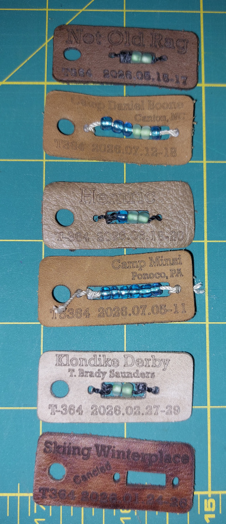
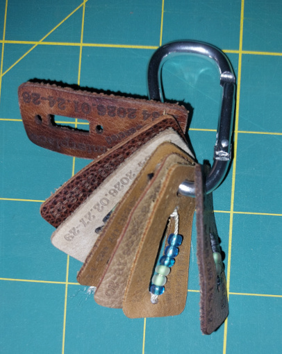

# Camping Beads Troops 364 and 5364

Camping beads are a long tradition in scouting. They are a physical representation of the number of days a scout camped and the weather of the campout.

## Bead Colors

| Color | Meaning |
| --- | --- |
| Green | Fair weather |
| Blue | Rain |
| White | Snow |
| Red | Over 90 F |
| Purple | Below 32 F and no snow |

## Our Version

We added a twist to the standard beads. We cut leather tags with a laser cutter and attach the beads to the leather.

Each tag gives Scouts a record of where they camped, the month and year, and the weather during the campout. Over time, the tags become a keepsake of their camping experiences.

We get the leather as inexpensive leather scraps on Amazon.

## Template

The main idea is two layers. 

- Line layer - that has the text 10% power and 800 mms on a 14 watt diode laser. Use solid infill for the text to improve readability.
- cut layer - 70% power 450 to 500 mms speed

Put the text on the line layer.

It works well to type up one example, then copy and paste it to make 10 to 20 tags at a time.

The original design was created in Inkscape, but the text engine in the laser-cutter software can also be used.

An inexpensive AtomStack laser cutter has worked well for this project.

Download or view these bead design files as templates:

- [:material-file-download: 20206-01-skiing-example.svg](20206-01-skiing-example.svg) — SVG template for laser cutting
- [:material-file-code: 20206-01-skiing 5364.atom](20206-01-skiing%205364.atom) — Atom design file
- [:material-file-code: 2026-02-T-Brady-klondike-364.atom](2026-02-T-Brady-klondike-364.atom) — Klondike Derby 2026 (Troop 364)
- [:material-file-code: 2026-02-T-Brady-klondike-5364.atom](2026-02-T-Brady-klondike-5364.atom) — Klondike Derby 2026 (Troop 5364)

## Photos

{ width="350" }

{ width="350" }

The beads can be easily added to a small keychain carabiner and clipped to a belt or belt loop.

## Time and Materials

After printing the tags, it takes about 1 hour to make 40 tags.

- Leather scraps: about $20 is often enough to make 300 tags.
- Keychain carabiners: about $10 for 30.
- Durable nylon thread for the beads: about $5 for enough to make several thousand tags.
- Glue or wax: secures the knots tied to the leather and helps prevent knot slippage.
