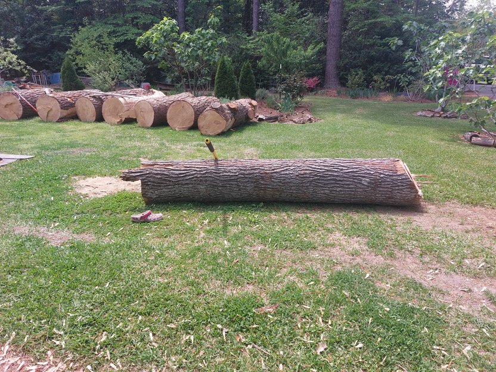
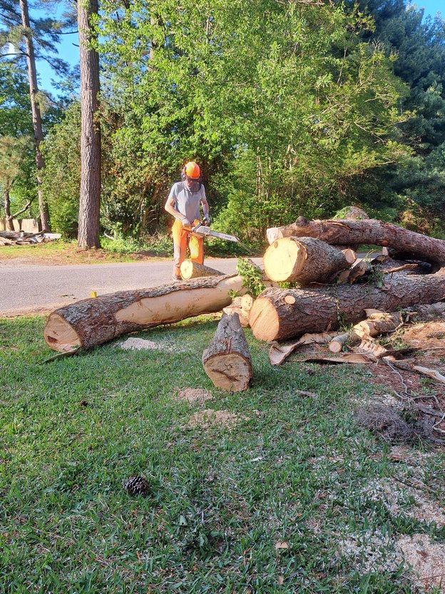
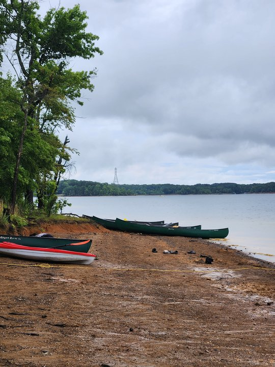
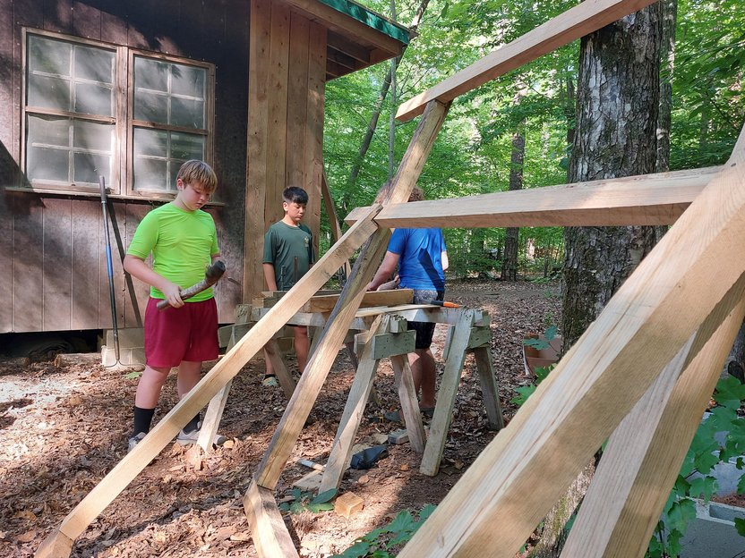
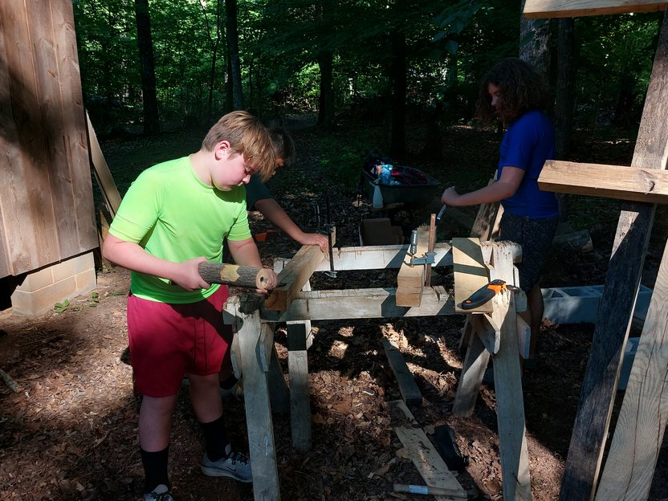
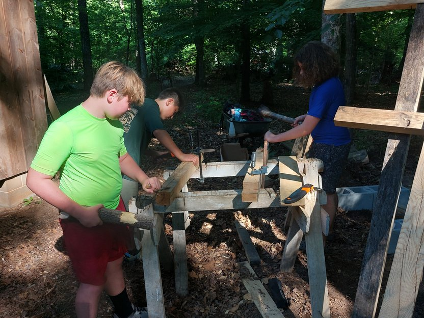
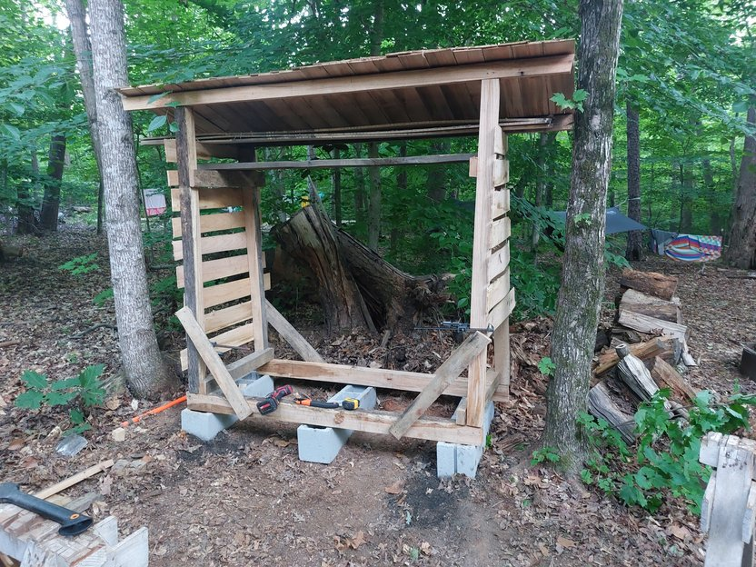
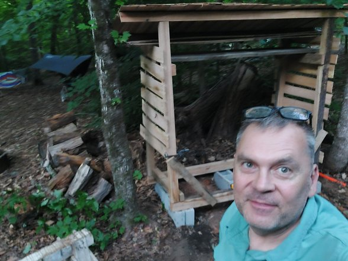
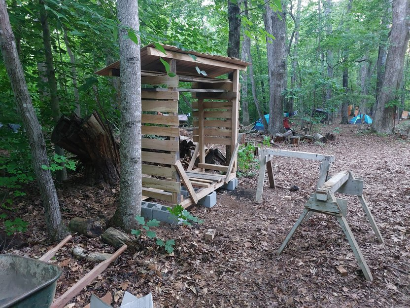

---
hide:
  - toc
---

# Hemric Island Firewood Shelter

A Scout service project at Hemric Island Scout Reservation

We built a shelter to keep firewood dry—and got every piece of wood to the island by canoe.

## A project shaped by the island

Building on an island means planning for the crossing as well as the construction. All the wood for the shelter traveled to Hemric Island by canoe. Some tools may have come over by powerboat.

The canoe crossing had a story of its own: a major storm caught us on the way over. Getting people and gear out of the rain came first, so there are no photos of that part of the trip. The pictures begin once the work was underway.

## Cutting and fitting the frame

The shelter was built with mortise-and-tenon joinery. The joints were cut on the island, and the Scouts fitted the frame pieces together on site. It was hands-on woodworking from the first cuts through assembly.

## A roof for dry firewood

Thin hardwood shingles cover the shelter. They provide a roof for now, with the option to upgrade it in the future if the shingles need to be replaced or a different roofing material proves more suitable.

## The project in pictures

  <figure>
    
    <figcaption>Logs ready for cutting and preparation.</figcaption>
  </figure>
  <figure>
    
    <figcaption>Preparing the timber for the build.</figcaption>
  </figure>
  <figure>
    
    <figcaption>Canoes at the shore—the wood's ride to the island.</figcaption>
  </figure>
  <figure>
    
    <figcaption>Laying out and preparing the frame pieces.</figcaption>
  </figure>
  <figure>
    
    <figcaption>Cutting and fitting the joinery on the island.</figcaption>
  </figure>
  <figure>
    
    <figcaption>Fitting the mortise-and-tenon frame.</figcaption>
  </figure>
  <figure>
    
    <figcaption>The shelter taking shape beneath its hardwood-shingle roof.</figcaption>
  </figure>
  <figure>
    
    <figcaption>A quick progress check beside the shelter.</figcaption>
  </figure>
  <figure>
    
    <figcaption>The finished shelter, ready to help keep firewood dry.</figcaption>
  </figure>

